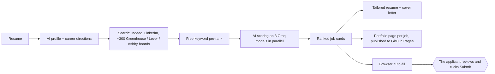

# Smart Job Assistant

A job-search tool I built and use myself. Upload a resume and it reads it into a profile, suggests career
directions, finds live jobs on Indeed, LinkedIn and about 300 company career boards, ranks every posting
against the resume, and prepares each application: a tailored resume, a cover letter, a portfolio website
for that one job, and a browser helper that fills the form for the applicant to check and submit.

Built by **Hari Prasath Sundaresan** · [Portfolio](https://h2hofficially.github.io/portfolio/) ·
[LinkedIn](https://www.linkedin.com/in/h2hofficially)

> **All rights reserved.** This code is public so you can read it. It is not open source: see [LICENSE](LICENSE).

## How it works



## What's worth a look

| File | What it shows |
|---|---|
| `matcher.py` | Resume to profile, career directions, two-stage ranking (free keyword pre-rank, then LLM scoring with strict JSON schemas) |
| `llm.py` | One worker per Groq model to multiply free-tier throughput; fallbacks when a model hits its daily cap |
| `boards.py` | Public Greenhouse, Lever and Ashby APIs instead of scraping; learns new company boards from apply links |
| `portfolio.py` | A one-page site per job where every claim is copied from a fact bank; the AI only picks fact ids, and code rejects invented numbers or tools |
| `autofill.py` | Playwright form filling by field label, colour-coded for review; never clicks Submit, never touches LinkedIn or Indeed forms |
| `check_*.py` | Acceptance checks written before each feature, including prompt-injection and HTML-escaping cases |
| `DESIGN.md` | The decisions behind it: rate limits, security fixes, what was tried and rejected |

## Stack

Python · Streamlit · Groq (gpt-oss-120b, gpt-oss-20b, Qwen) · LangChain · python-jobspy · Playwright ·
GitHub contents API + GitHub Pages

## Running it

Requires Python 3.10+, a Groq API key and, for auto-fill, Chrome or Playwright's Chromium.

```
python -m venv venv
venv\Scripts\python -m pip install -r requirements.txt
venv\Scripts\python -m pip install --no-deps python-jobspy==1.1.82
copy .env.example .env        (then add GROQ_API_KEY)
venv\Scripts\streamlit run app.py
```

Portfolio pages need a fact bank at `my_data/portfolio_bank.json`; `portfolio_bank.example.json` shows the format.
